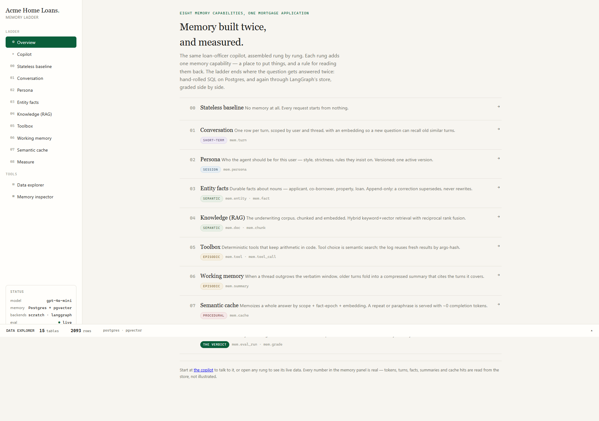
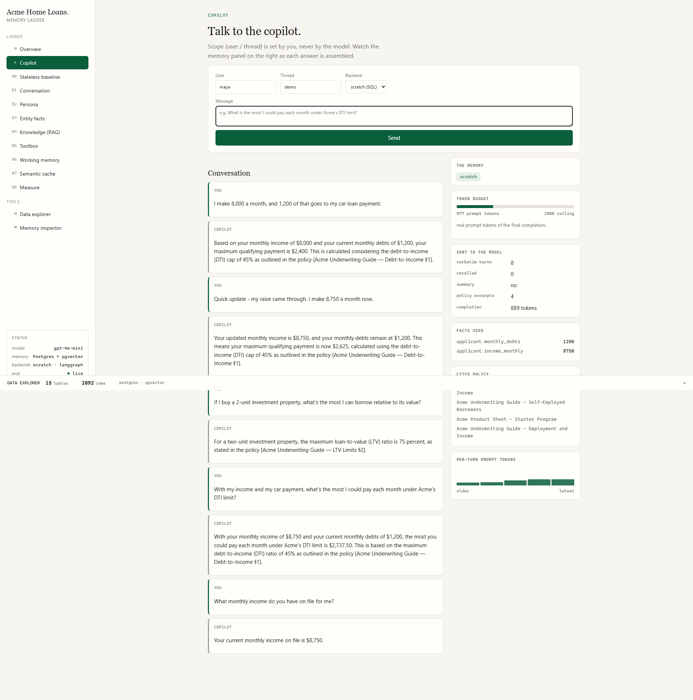
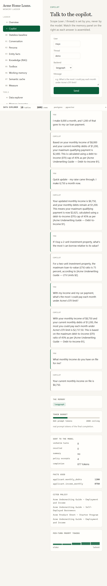
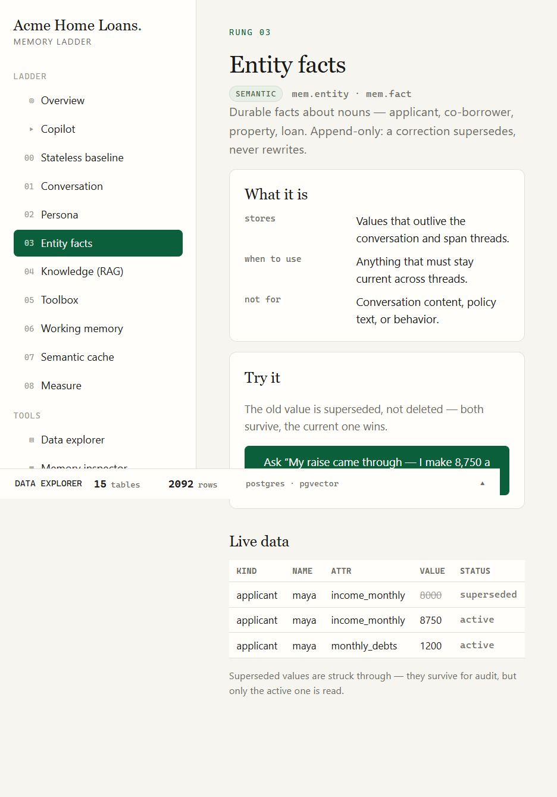
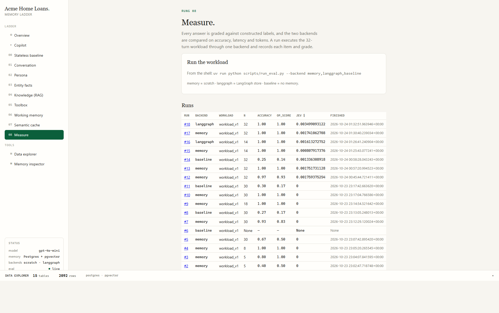
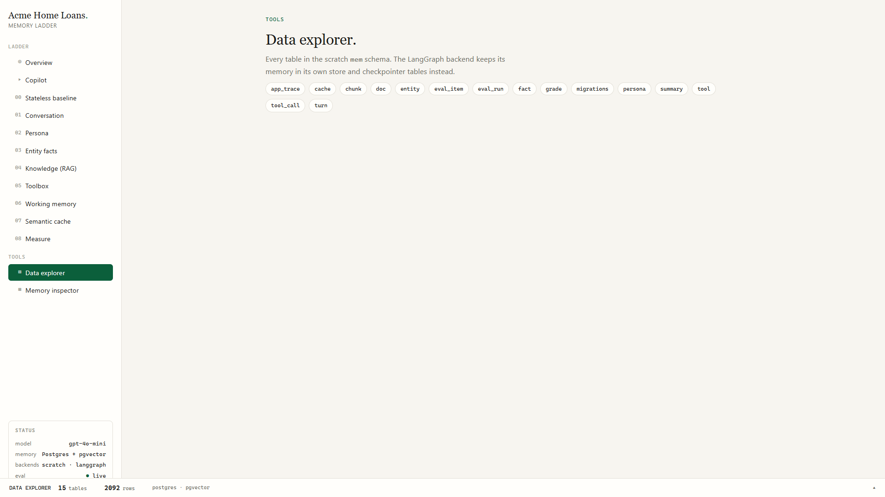

# Acme Loan Copilot — agent memory built twice

A v1 modeled on Part 7 of [RichmondAlake's agent_memory_course](https://github.com/RichmondAlake/agent_memory_course):
an agent-memory system built **from scratch as SQL on Postgres**, then again **through
LangGraph's store and checkpointer**, and evaluated so the two designs can be compared on
accuracy, latency, tokens and cost. Domain: **Acme Home Loans**, a loan-officer copilot.

The copilot remembers the applicant, corrects itself when facts change (supersession), never
leaks one applicant's data to another (scope), grounds policy answers in a cited corpus, and
keeps arithmetic inside deterministic tools — never in the model's head.

## Stack

- **Postgres 16 + pgvector** in Docker — two databases: `agentmem` (scratch) and `agentmem_lg` (LangGraph)
- **Python 3.12** via `uv` (venv lives *outside* the OneDrive-synced folder)
- **OpenRouter** — one OpenAI-compatible key covers chat and embeddings; the eval judge is a configurable model (`MEM_JUDGE_MODEL`), currently gated off
- **LangGraph** `PostgresStore` + `PostgresSaver` for the second backend
- **FastAPI** for the app pages

## Setup

```powershell
# 1. Database (Docker Desktop must be running)
cd infra
docker compose up -d

# 2. Python environment
cd ..
uv sync
# if your project lives in a synced folder (OneDrive/Dropbox), keep the venv out
# of it:  $env:UV_PROJECT_ENVIRONMENT = "$HOME/.venvs/agent-memory"  then re-run uv sync

# 3. Keys
Copy-Item .env.example .env   # put an OpenAI/OpenRouter key in MEM_API_KEY (optional MEM_JEV_KEY)

# 4. Migrations + corpus
uv run python -m agentmem.db
uv run python scripts/seed_kb.py
```

Two Windows gotchas baked into the config:

- The venv path is set per-shell with `UV_PROJECT_ENVIRONMENT` so OneDrive never syncs it.
- DSNs use `127.0.0.1`, not `localhost` — Docker maps the port on IPv4 only here, and
  libpq's first attempt on `::1` hangs instead of failing fast.

## Run it

```powershell
# Web app (chat / memory inspector / data explorer / evals)
uv run python scripts/serve.py --port 8730     # then open http://127.0.0.1:8730

# One-shot chat smoke test
uv run python scripts/smoke_chat.py

# Demos (each exercises one memory unit)
uv run python scripts/demo_baseline.py
uv run python scripts/demo_kb.py
uv run python scripts/demo_tools.py
```

## Evaluate it

```powershell
# Golden workload through one or more backends (persists to mem.eval_*)
uv run python scripts/run_eval.py --backend memory,langgraph,baseline

# Validate the graders against constructed labels (prints the κ table)
uv run python scripts/validate_graders.py

# Five very different questions, on both backends, with assertions (exit 0 = all pass)
uv run python scripts/demo_check.py
```

### Results (32-turn workload, cold cache, 1 repeat)

Artifacts with commit, model IDs, workload hash, denominators and CIs live in
[`docs/evidence/`](docs/evidence/) (`workload-run.json`, `grader-validation.json`).

| backend | n | accuracy (95% CI) | op_score (95% CI) | p50 | note |
|---|---|---|---|---|---|
| memory (scratch) | 32 | **1.00** (0.89–1.00) | **1.00** (0.78–1.00) | ~4.2s | + summaries + semantic cache |
| langgraph | 32 | **1.00** (0.89–1.00) | **1.00** (0.78–1.00) | ~3.2s | equivalent on the memory promises |
| baseline | 32 | 0.28 (0.16–0.45) | 0.14 | ~1.2s | no memory at all |

Measured at commit `71dfaeb`; artifacts with commit, model IDs, workload hash,
denominators and CIs live in [`docs/evidence/`](docs/evidence/). A held-out check
(`scripts/heldout_check.py`, 5 fresh questions not in the workload) also passes 5/5,
so the supersession guard is not tuned only to the 32-item set.

At n=32 a 1.00 has a Wilson lower bound of 0.89 — the interval is the honest number.
Per-category (memory, passed/n): tool 5/5 · scope 2/2 · setup 3/3 · recall 7/7 ·
smalltalk 3/3 · kb_grounding 7/7 · entity_update 2/2 · cross_thread_recall 1/1 ·
entity_update_setup 1/1 · same_turn_correction 1/1.

Grader authority (pre-declared rule: highest κ ≥ 0.6 wins per check): **6 deterministic
checks → code** (κ = 1.0); **3 judgment checks → Jev** (`forbidden_absent` 1.0,
`answer_grounded` 0.79, `failure_mode` 0.83); `answer_quality` is a soft signal (±1 = 0.99);
the LLM judge is gated off because it never beat Jev. A full Jev validation run costs ~$0.004.

## Screenshots

The Memory Ladder app (run `uv run python scripts/serve.py`, then open http://127.0.0.1:8730):













## Tests

```powershell
uv run pytest          # 146 passed, 1 skipped (DB required); 3 live deselected
uv run pytest -m live  # the 3 paid live-model tests (need MEM_API_KEY)
```

Tests are tagged `db` (needs Postgres) and `live` (paid calls). The default
selection excludes `live`; `db` tests skip cleanly when Postgres is unreachable.

## Milestones

| # | Milestone | Status |
|---|---|---|
| 0 | Foundation: infra, migrations, adapters, contracts | **done** |
| 1 | Conversation + persona | **done** |
| 2 | Entity memory + supersession (corrected income resolves, stale excluded) | **done** |
| 3 | Knowledge base + hybrid RRF retrieval + cited answers + guarded extraction | **done** |
| 4 | Toolbox + tool log (semantic tool choice, args-hash cache, artifact offload, planner loop) | **done** |
| 5 | Working memory + summaries + semantic answer cache | **done** |
| 6 | Evaluation harness (constructed-label validation, code→Jev→judge cascade, κ table) | **done** |
| 7 | LangGraph backend + comparison | **done** |
| 8 | App: chat, memory inspector, data explorer, evals | **done** |
| 9 | Docs: unit pages, diagrams, README | **done** |

## Docs

- [Units](docs/units.md) — what each memory unit stores, when to use it, what it is *not* for
- [Architecture](docs/architecture.md) — schema, context assembly, and grader-cascade diagrams
- [Backends](docs/backends.md) — scratch SQL vs LangGraph, side by side
- [Security](docs/security.md) — what fact-history protection enforces, and what it does not
- [Evaluation](docs/evaluation.md) — the harness, grader authority, and results

Design notes and the evaluation methodology live in [`docs/`](docs/).
