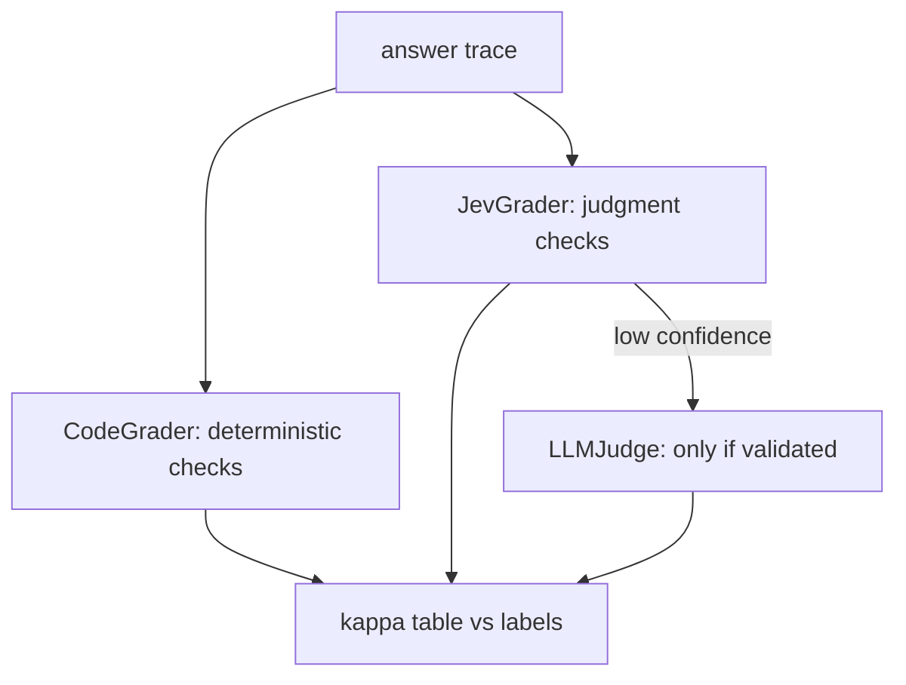
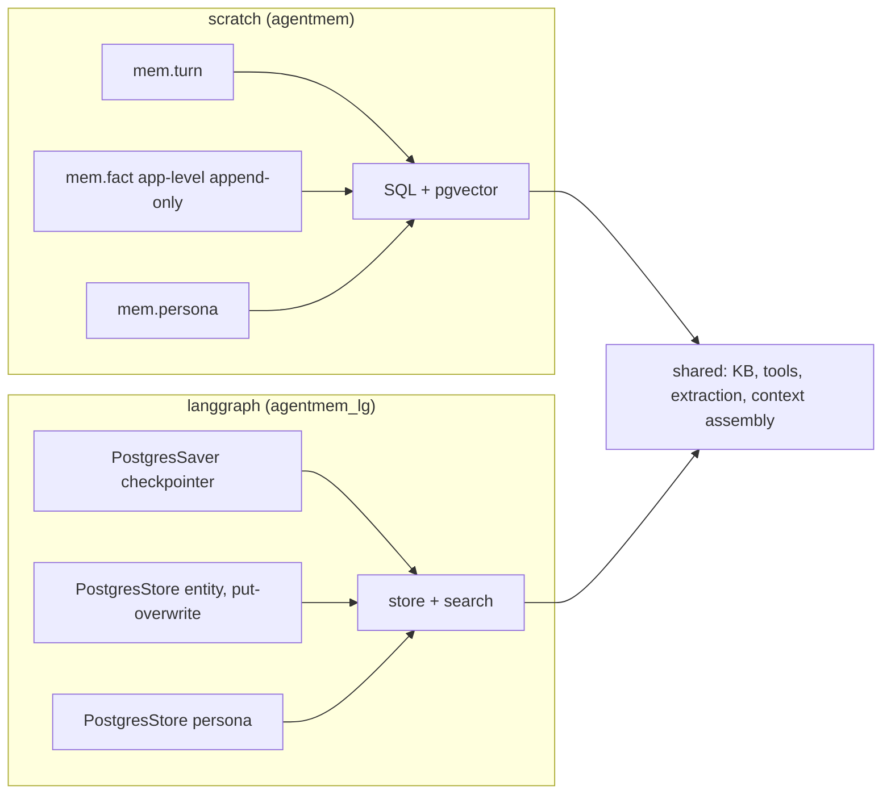

# Architecture

## Memory schema (scratch backend, `agentmem`)

```mermaid
erDiagram
    persona ||--o{ persona : supersedes
    entity ||--o{ fact : "has (app-level append-only)"
    fact ||--o{ fact : supersedes
    turn }o--|| thread : "belongs to"
    doc ||--o{ chunk : chunks
    summary }o--o{ turn : "cites (turn ids)"
    cache }o--|| user : "memoized answer"
    tool_call }o--|| tool : "ran"

    persona { bigint persona_id, text user_id, int version, text change_trigger, jsonb body, text status }
    entity { bigint entity_id, text user_id, text kind, text name }
    fact { bigint fact_id, bigint entity_id, text attr, jsonb value, bigint supersedes_id, text status }
    turn { bigint turn_id, text user_id, text thread_id, int seq, text role, text content, vector embedding }
    doc { bigint doc_id, text title, text version }
    chunk { bigint chunk_id, bigint doc_id, int chunk_index, text text, vector embedding }
    summary { bigint summary_id, text user_id, text thread_id, int version, bigint[] source_turn_ids, int covers_through_seq, text text }
    cache { bigint cache_id, text user_id, text thread_id, bigint epoch, text question, text answer, vector embedding }
    tool { bigint tool_id, text name, jsonb params_hint, int ttl_default, vector embedding }
    tool_call { bigint call_id, text user_id, bigint tool_id, text args_hash, jsonb args, text source, jsonb result }
```

## Context assembly order

Every answer builds its prompt from the memory units in a fixed priority order; the
verbatim recency window is already bounded, and a soft token budget trims the lowest
priority (recalled turns, then policy excerpts) when the estimate exceeds the ceiling.

```mermaid
flowchart LR
    Q[user turn] --> E[extract + validate facts]
    E --> P[persona]
    P --> F[entity facts]
    F --> S[working-memory summary]
    S --> R[recency window]
    R --> C[semantic recall]
    C --> K[policy excerpts]
    K --> A[assemble + budget]
    A --> T[tool loop]
    T --> O[answer + verify]
```



## Grader cascade

Deterministic checks are graded by code; judgment checks go to Jev (a decision model),
with an LLM judge reserved as a tie-breaker that is currently gated off because it never
beat Jev on a validated check.



## Backend contrast



## Unit of work

The **caller owns the commit boundary**. Units never call `conn.commit()` or
`conn.rollback()` directly; every write goes through `with conn.transaction():`,
which is a savepoint when an outer transaction already exists and a real
transaction otherwise. So:

- a single unit write (`entity.write_fact`, `persona.update`) is atomic on its own;
- a caller can group several writes into one atomic unit by wrapping them in
  `with conn.transaction():` — the nested unit blocks become savepoints and a
  failure rolls the whole group back;
- no unit can commit an outer transaction early.

Enforced by convention: `grep -r "conn.commit()" src/agentmem/units` must be empty.
